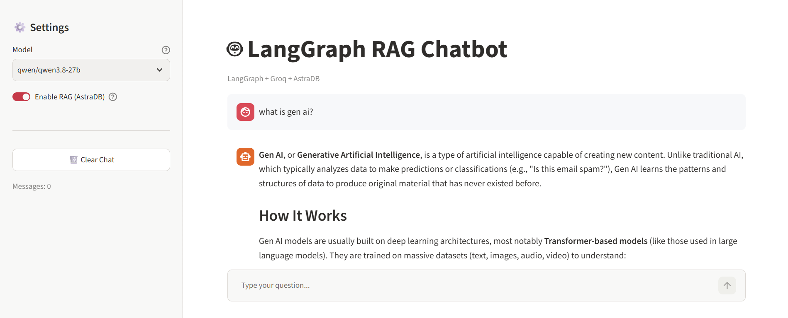
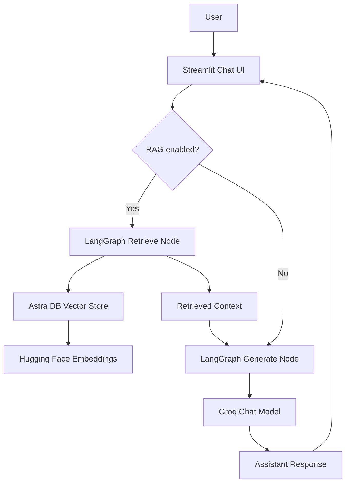

# LangGraph RAG Chatbot



A conversational AI application built with **Streamlit, LangGraph, Groq, and Astra DB**. It supports two modes:

- **RAG mode:** retrieves relevant document chunks from an Astra DB vector collection and supplies them as context to the language model.
- **Chat mode:** disables retrieval and sends the conversation history directly to the language model.

The project uses LangGraph to define and execute the chatbot workflow, Hugging Face sentence embeddings for semantic retrieval, and Groq-hosted chat models for response generation.

## Features

- Interactive Streamlit chat interface
- LangGraph state graph for orchestration
- Retrieval-Augmented Generation (RAG) using Astra DB
- Semantic embeddings with `sentence-transformers/all-MiniLM-L6-v2`
- Configurable Groq model selection in the sidebar
- Toggle between RAG and standard chatbot modes
- Conversation history maintained during the Streamlit session
- Clear-chat control
- Cached vector retriever and compiled graph for improved app responsiveness
- Local environment-variable support and Streamlit Cloud secrets support

## Architecture



### LangGraph workflow

**When RAG is enabled:**

`START → retrieve → generate → END`

1. The retrieve node takes the latest user message and searches the Astra DB vector collection.
2. The top 4 matching documents are retrieved by default.
3. Their page content is combined into a context string.
4. The generate node adds a system instruction requiring the model to answer only from the supplied context, then invokes the Groq model.

**When RAG is disabled:**

`START → generate → END`

The model receives the conversation history without retrieved document context.

## Tech Stack

| Component | Technology | Purpose |
|---|---|---|
| User interface | Streamlit | Chat interface and controls |
| Workflow orchestration | LangGraph | Stateful retrieval and generation graph |
| LLM provider | Groq | Chat completion |
| Vector database | DataStax Astra DB | Stores and retrieves document vectors |
| Embedding model | Hugging Face `all-MiniLM-L6-v2` | Converts text into embeddings |
| Integration layer | LangChain | Connects models, embeddings, and vector store |
| Configuration | python-dotenv / Streamlit Secrets | Manages credentials |

## Project Structure

```text
LangGraph-RAG-Chatbot/
├── app.py
├── requirements.txt
├── .gitignore
└── README.md
```

## Prerequisites

Before running the project, make sure you have:

- Python 3.10 or later
- A [Groq API key](https://console.groq.com/keys)
- A [DataStax Astra DB](https://astra.datastax.com/) database and application token (required for RAG mode)
- Git

> **Note:** The application expects an Astra DB collection named `langgraph` by default. The collection must contain documents that have been indexed using the same embedding model. This repository currently implements retrieval and chat; it does not include a document-upload or ingestion interface.

## Installation

### 1. Clone the repository

```bash
git clone https://github.com/Tauhid-Topu-007/LangGraph-RAG-Chatbot.git
cd LangGraph-RAG-Chatbot
```

### 2. Create and activate a virtual environment

**Windows (PowerShell):**

```powershell
python -m venv .venv
.\.venv\Scripts\Activate.ps1
```

**macOS / Linux:**

```bash
python3 -m venv .venv
source .venv/bin/activate
```

### 3. Install dependencies

```bash
python -m pip install --upgrade pip
pip install -r requirements.txt
```

### 4. Configure environment variables

Create a file named `.env` in the project root:

```env
groq_api_key=your_groq_api_key
ASTRA_DB_APPLICATION_TOKEN=your_astra_db_application_token
ASTRA_DB_API_ENDPOINT=https://your-database-id-your-region.apps.astra.datastax.com
```

- `groq_api_key` is required for both chat modes.
- `ASTRA_DB_APPLICATION_TOKEN` and `ASTRA_DB_API_ENDPOINT` are required when RAG is enabled.
- Keep credentials private. Never commit `.env` or expose API keys in source code.

### 5. Prepare Astra DB for RAG

1. Create an Astra DB database.
2. Generate an application token with permissions to access the database.
3. Copy the database API endpoint and token into your `.env` file.
4. Create/populate a collection named `langgraph` using the same embedding model: `sentence-transformers/all-MiniLM-L6-v2`.

The application initializes an Astra DB vector store for the `langgraph` collection and retrieves the four most relevant documents for each user query. If your collection uses a different name, update the default `collection_name` in `get_retriever()` inside `app.py`.

## Run the Application

Start the Streamlit app:

```bash
streamlit run app.py
```

Streamlit will print a local URL (usually http://localhost:8501). Open it in your browser.

## How to Use

1. Launch the application.
2. Select an available Groq model from the sidebar.
3. Keep **Enable RAG (AstraDB)** switched on to answer using retrieved documents, or switch it off for a standard LLM chatbot.
4. Enter a question in the chat input.
5. Use **Clear Chat** to reset the conversation history.

### Model configuration

The current model choices are defined directly in `app.py`:

- `qwen/qwen3.8-27b` (default)
- `openai/gpt-oss-safeguard-20b`
- `minimaxai/minimax-m2.7`
- `meta-models/muse-spark-open`

Model availability depends on your Groq account, API access, and the provider's current model catalogue. If a selected model is unavailable, replace its identifier in the model list with a currently supported Groq model.

## Deploy on Streamlit Community Cloud

1. Push the project to a GitHub repository.
2. Open [Streamlit Community Cloud](https://share.streamlit.io/) and create a new app.
3. Select this repository, the `main` branch, and `app.py`.
4. Open the app's **Settings → Secrets** section.
5. Add the following secrets in TOML format:

```toml
groq_api_key = "your_groq_api_key"
ASTRA_DB_APPLICATION_TOKEN = "your_astra_db_application_token"
ASTRA_DB_API_ENDPOINT = "https://your-database-id-your-region.apps.astra.datastax.com"
```

6. Save the secrets and deploy the app.

For deployment in standard Streamlit Cloud, the app reads credentials from `st.secrets`; locally, it falls back to the `.env` file.

## Important Notes and Limitations

- RAG quality depends on the relevance, coverage, and freshness of documents stored in Astra DB.
- The app retrieves the top 4 documents by default; this can be adjusted through `search_kwargs` in `get_retriever()`.
- The current implementation does not provide document ingestion, file upload, source citations, user authentication, or persistent chat history.
- Chat history is stored in Streamlit session state and is not a permanent conversation database.
- In RAG mode, the system prompt instructs the model to answer only from retrieved context. This is a prompt-level constraint, not a formal guarantee against hallucinations.
- Keep all API credentials in environment variables or deployment secrets.

## Troubleshooting

| Problem | What to check |
|---|---|
| Groq authentication error | Verify `groq_api_key` and confirm the key is active. |
| Model not found / unavailable | Check the model ID and your Groq account's model access. |
| Astra DB connection error | Verify the API endpoint, application token, database status, and network access. |
| Empty or irrelevant RAG answers | Confirm that the `langgraph` collection contains indexed documents created with the same embedding model. |
| Missing Python package | Activate the virtual environment and run `pip install -r requirements.txt`. |

## Future Improvements

- Add PDF, DOCX, TXT, and web-page ingestion
- Build a document-management interface
- Add source attribution and retrieved-document previews
- Support configurable retrieval count and similarity thresholds
- Add conversation persistence and export
- Add streaming responses and LangGraph execution visualization
- Add evaluation for retrieval quality and answer faithfulness
- Add Docker support and automated tests

## Author

**Tauhidul Islam Topu**

- GitHub: [@Tauhid-Topu-007](https://github.com/Tauhid-Topu-007)
- LinkedIn: [Tauhidul Islam Topu](https://www.linkedin.com/in/tauhidul-islam-topu-1a04b31ab/)

---

If you find this project useful, consider giving the repository a ⭐ on GitHub.
